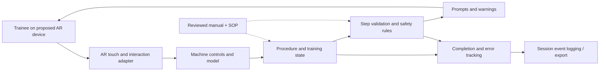

# Technical Design — Wood-Processing Machine XR Training System

**Status:** Living draft; verify against the exact Week 5 checkpoint commit  
**Stack (confirmed):** Unity 6.6 (6000.6.5f1), C#; Unity project under `Unity Project Files/Demo Interactive Application/` (**[VERIFY at commit]**). **Team-selected mobile build/AR requirements:** Unity built-in Build Profiles, Android/iOS/macOS Build Support, AR Foundation, ARCore XR Plug-in, ARKit XR Plug-in, XR Plug-in Management and XR Interaction Toolkit.  
**Official product scope:** XR machine-operation/safety training, with startup, operation, shutdown, feedback, error/progress tracking and data logging  
**Fall Week 10 provisional delivery plan (PM decision, 2026-11-01):** Android AR through **Google Play internal testing** and iOS AR through **Apple TestFlight external beta testing**. No partner-confirmed delivery platform currently exists.
**Project management:** Owen Koster coordinates partner decisions, sprint/deployment milestones, risks and checkpoint evidence; an AR technical implementer must be assigned separately.

> This document deliberately separates **current reported code** from **future ideas**. No proposed component or diagram below should be interpreted as implemented until checked in the repository.

## 1. System context

The team is developing a training application for students and new operators of a woodworking press. The official project requirements call for a machine/workspace representation, interactive machine components, structured startup/operating/shutdown procedures, safety checks, mistake detection, prompts and feedback, tracking of completion/errors/progress, data logging for later analysis, reusable architecture, and technical/user documentation. The current Unity interaction prototype establishes basic object selection and transform controls. The anticipated Week 10 walking skeleton moves that interaction into a phone/tablet AR experience.

```text
  Machine manuals / SOP / review notes
               |
        reviewed training rules      Product owner / reviewer
               |                          |
               v                          v
    +--------------------------------------------+
    | Unity / C# training application             |
    | Model + interactions + training procedures  |
    | Safety feedback + progress + event logging  |
    +--------------------------------------------+
               ^
               |
     Trainee on phone/tablet
        (Week 10 target)
```

The simulator **must not control the physical press**. This is a **proposed scope boundary**, pending partner confirmation.

## 2. Current implementation — reported, verify at commit

The following reflects earlier team work, not a repository inspection:

| Component | Reported responsibility | Verification needed |
| --- | --- | --- |
| `InputMaster` | Subscribes to the generated Input System `Player.Attack` action in `Start()`. While pressed, `FixedUpdate()` avoids UI pointer hits, reads `Mouse.current.position`, casts `Camera.main.ScreenPointToRay`, sets `SelectedObject` to the hit collider's `GameObject`, then calls `Interactable.OnInteract()` if present. | Source provided by team; On a *miss*, current code does **not** clear an earlier selection. |
| `TranslationInteraction` | Shows a TextMeshPro-driven panel when an object is selected and provides X/Y/Z position editing. | Implemented |
| `RotationInteraction` | Provides X/Y/Z rotation controls with TextMeshPro numeric input and a panel shown for selected objects. | Implemented |
| RGB color adjustment | Investigated/assigned as a separate interaction feature. | Implemented |
| CI workflows | Team now maintains **separate** `CI Build` and `Unity PlayMode Tests` workflows, each with its own checkout. Build targets `StandaloneLinux64`; test job uses GameCI PlayMode runner and publishes XML as an artifact. | GameCI test XML reported **1/1 passed**; independent workflow final success and intentional failing run remain. |

The original development interaction system is **not yet evidence of a working AR application**. **The team has selected Unity's existing AR/XR stack rather than creating a new framework.** Integration of these editor/desktop controls with XR Interaction Toolkit and phone/tablet touch input remains implementation work; this decision does not mean mobile interaction already exists.

### Current reported interaction contract

```text
Input System Player.Attack (performed/canceled)
    -> InputMaster.pressed boolean
    -> FixedUpdate: if pressed and not over UI, camera mouse-raycast
    -> Collider hit: SelectedObject = hit.collider.gameObject
    -> If Interactable component exists: OnInteract()
    -> Translation/Rotation UI can read SelectedObject and edit Transform
```

- `SelectedObject` is initialized as `null` and assigned on a raycast hit. The current supplied `InputMaster` does **not** set it back to `null` when a raycast misses; do not claim automatic deselection. Holding `Attack` may call `OnInteract()` repeatedly across fixed updates; review whether this is intended for machine-control actions.
- A missing selection must not produce a transform operation; the UI should be hidden or inactive.
- The transform scripts currently operate on the Unity `Transform` of a selected object. 
- Exact class/function signatures belong in the code; include stable public contracts here once verified.

## 3. Proposed next-stage architecture — not implemented



This is a **proposed** system decomposition, **not** a map of implemented classes. The AR input/placement layer should use **AR Foundation, the platform providers, and XR Interaction Toolkit**, with application-specific adapters where needed; the team does **not** plan to write a replacement XR tracking or interaction framework. To cover the official objectives, a maintainable design needs to separate: (1) device input/AR placement; (2) machine visuals and actionable controls; (3) ordered startup/operation/shutdown procedures; (4) validation of correct/unsafe/out-of-sequence interactions; (5) instructional prompts and feedback; (6) session completion/progress/error tracking; and (7) recording/export of session events for later analysis. Preserve boundaries so new procedures or machines can reuse common behavior. Choose concrete Unity types, persistence and naming only after team review.

## 4. Interfaces and contracts

### Currently reported interfaces

| Boundary | Input | Output/contract | Status |
| --- | --- | --- | --- |
| Input -> selection | `Player.Attack` action, mouse position, main-camera physics raycast | On hit: `SelectedObject` becomes the collider's `GameObject`; may call `Interactable.OnInteract()`; on miss: keeps previous value | Supplied `InputMaster` code; **[VERIFY commit]** |
| Selection -> translation | Selected object + X/Y/Z TMP field values | Selected object's position changes after input | Reported current; **[VERIFY]** |
| Selection -> rotation | Selected object + X/Y/Z TMP field values | Selected object's rotation changes after input | Reported current; **[VERIFY]** |
| UI -> selection | UI input events | UI click should not select objects behind panel | Reported current; **[VERIFY]** |

### Contracts not decided yet

- **AR world placement:** How does the app place/anchor the press in the real scene? **[DECISION NEEDED]**
- **Mobile input:** Use **XR Interaction Toolkit** with Unity AR Foundation for the interaction foundation. The specific touch bindings, interactors, target objects and UI events for machine controls remain **[DECISION NEEDED]**; no custom XR framework is planned.
- **Procedure state:** How are separate startup, operation and shutdown/safe-state sequences represented, transitioned and completed? **[DECISION NEEDED]**
- **Safety validation:** What reviewed source authorizes each simulated warning/interlock, invalid-action case and corrective prompt? **[DECISION NEEDED]**
- **Progress and errors:** What counts as a completed step, an error or a completed session? How can the trainee/reviewer access these outcomes? **[DECISION NEEDED]**
- **Event log:** How are actions and outcomes recorded/exported for later analysis, and what privacy/access/retention rules apply? **[DECISION NEEDED]**
- **Asset handoff:** Required model formats, scale, orientation, mesh budgets, and Unity import path. **[DECISION NEEDED]**

## 5. Data model and assets

**Currently established (team-reported, not inspected):** Unity `GameObject`/`Transform` and `InputMaster` selection. **There is no verified implementation of session tracking or data logging yet.** Unlike earlier drafts, **the official project requirements explicitly require tracking completion/errors/progress and data logging for later analysis**. The exact storage technology, retention, privacy and any network service remain undecided; no user-account system was specified.

**Possible future logical data (proposed schema, not existing code):**

| Concept | Candidate fields (not a committed API) | Purpose |
| --- | --- | --- |
| Machine element | Element ID, label, model reference, permitted actions | Bind model controls to training actions |
| Procedure | Procedure ID, type (startup/operation/shutdown), ordered steps, source revision | Reuse reviewed training sequences |
| Training step | Step ID, instruction, prerequisites, required interaction, completion condition | Advance and validate sequences |
| Feedback / safety rule | Rule ID, condition, severity, message, SOP reference | Recognize errors and provide corrective feedback |
| Session state | Session ID, current procedure/step, completed tasks, error count, progress | Support ongoing feedback and training results |
| Session event | Timestamp, session ID, step ID, action, outcome/error category | Enable later analysis and export |

**[DECISION NEEDED]** Decide whether Unity C# objects, ScriptableObjects, scene references or external config represent steps; determine local storage/export or another approach to logging, event schema and data handling. The table is a conceptual aid, not a claim that fields/APIs exist.

### 3D reconstruction and content

The partner asked the team to investigate photogrammetry/3D reconstruction using photos and video. Team research has considered **RealityScan Desktop** and **Polycam Mobile** under an RFC, with a common-object capture-to-Unity workflow under evaluation.

Separate machine behavior/training rules from meshes where practical so placeholder models can later be replaced with captured geometry. Verify access to cameras, physical equipment, reference measurements, appropriate images, and permission to publish media.

## 6. Mobile AR platform and deployment design

### Selected build workflow and package requirements

The team selected Unity's **built-in Build Profiles/build pipeline** and the following **Unity Hub modules**: **Android Build Support** (with **Android SDK & NDK Tools** and **OpenJDK**), **iOS Build Support**, and **macOS Build Support**. The macOS module supports a macOS player target; **it is not a substitute** for an iOS build machine with **Xcode** and Apple code signing.

For phone/tablet augmented reality, the team selected these **Unity Package Manager requirements**:

| Package | Unity package identifier | Role | Configuration / status |
| --- | --- | --- | --- |
| AR Foundation | `com.unity.xr.arfoundation` | Shared AR session, tracking and interaction foundation | Required; **[VERIFY installed version]** |
| Google ARCore XR Plug-in | `com.unity.xr.arcore` | Android AR provider | Required; enable under Android in XR Plug-in Management; **[VERIFY]** |
| Apple ARKit XR Plug-in | `com.unity.xr.arkit` | iOS AR provider | Required; enable under iOS in XR Plug-in Management; **[VERIFY]** |
| XR Plug-in Management | `com.unity.xr.management` | Provider configuration/enabling | Required; may already be installed as a dependency; **[VERIFY]** |
| XR Interaction Toolkit | `com.unity.xr.interaction.toolkit` | Unity-provided components for interacting with XR/AR objects | Required by team decision; XR toolkit reportedly installed, but **[VERIFY exact installed package and version]** |

Use compatible provider and AR Foundation versions supported by **Unity 6000.6.5f1**, recording selected versions in `Packages/manifest.json` and `Packages/packages-lock.json`. The **five-package Unity AR stack is a confirmed team choice**, not an invitation to evaluate or build a competing XR framework. Unity/AR provider code handles tracking and sessions, XR Interaction Toolkit supplies reusable interaction components, and the team implements the machine training behavior on top. The decision does **not** prove installation, configuration, mobile input, or successful AR behavior: check the manifest, provider settings, and device smoke tests. **ARCore Extensions is not currently a required package.**

Reference: [Unity AR Foundation setup](https://docs.unity.cn/Packages/com.unity.xr.arfoundation%406.6/manual/project-setup/install-arfoundation.html); [Google ARCore + AR Foundation](https://developers.google.com/ar/develop/unity-arf/getting-started-ar-foundation).

### Week 10 delivery — provisional decision by project manager

**Decision record (2026-11-01; owner: Owen Koster, project manager):** The partner has described the expected XR trainer but **has not identified or approved a delivery platform**. To establish a concrete, reviewable Week 10 plan, Owen is provisionally choosing **Google Play internal testing for Android** and **Apple TestFlight external beta testing for iOS**. These are **working assumptions**, not partner requirements, a full-team ratification, or proof that accounts or releases exist. The intent is an installable **phone/tablet AR walking skeleton** on both platforms without a public store launch. **Rationale:** non-team users could install a test build through a standard mobile channel rather than manually transferring a Unity project or sideloading an app.

**Decision status:** *Provisional — requires Product Owner/mentor discussion and technical/access feasibility checks.* If the partner prefers another route, or developer accounts, signing, devices, or review timing prevent these releases, record a revised delivery decision and update the deployment plan and risks. Do not claim Week 5 partner agreement until it actually happens.

**Current proposed channels:**

| Platform | Week 10 production/distribution channel | Build and installation route | External user evidence |
| --- | --- | --- | --- |
| **Android** | **Google Play Console — Internal testing** | Unity Android **App Bundle (`.aab`)**; sign/upload to Play Console; configure internal testers; share Play opt-in link (internal testing supports up to 100 testers). | A **non-team tester** opts in, installs via Google Play, launches AR on a compatible Android device and tests a guided interaction. Provide testing release and opt-in links on milestone cover where accessible. |
| **iOS/iPadOS** | **Apple App Store Connect — TestFlight external beta testing** | Unity iOS project built/signed via **Xcode on macOS**; upload to App Store Connect, add an external TestFlight group and complete applicable **Apple beta app review** before inviting non-team testers. | A **non-team tester** accepts a TestFlight invitation/public link, installs on a compatible iPhone/iPad, launches AR and tests a guided interaction. Provide channel/invite evidence on milestone cover where accessible. |

The **Week 10 scope** is a deployable walking skeleton with a machine representation, a meaningful machine interaction and a small guided training step with feedback. The **official full-project deliverables** additionally require complete startup, operation, shutdown/safe-state, warning/error detection, progress tracking, logging, reusable architecture and documentation. A Week 10 deployment is **not** a claim those full objectives are already completed.

**Product-owner/mentor agreement:** **Not confirmed.** Owen Koster (PM) owns presenting this provisional decision and recording the partner's response, including the date and any revised channel/scope. A PM decision alone **does not satisfy** the course's Week 5 requirement that the production target be agreed with the partner or mentor. **[VERIFY date requested, response, and evidence.]**

**Required channel decisions and ownership**

| Requirement | Current state and next verification | Accountability |
| --- | --- | --- |
| Google Play Console account and app signing | **[VERIFY account holder, whether university/partner account is available, developer permissions, signing/Play App Signing setup, package ID, test group, opt-in link.]** | Owen Koster — coordinate access/milestone; **[ASSIGN Android publisher]** |
| Apple Developer / App Store Connect account | **[VERIFY account holder, program enrollment, App Store Connect roles, Bundle ID, signing certificates/profiles, macOS with Xcode, beta review timing, invitation link.]** | Owen Koster — coordinate access/milestone; **[ASSIGN iOS publisher]** |
| Supported test devices | **[VERIFY named ARCore-supported Android device(s), ARKit-compatible iPhone/iPad, operating system versions, testers and whether devices can access the channels.]** | Owen Koster — schedule evidence; **[ASSIGN device testers]** |
| Product-owner agreement | **[VERIFY date and documented agreement with these two channels and the Week 10 walking skeleton.]** | Owen Koster — partner liaison |
| Evidence for Week 5 and Week 10 | Week 5: link to this deployment section and record accountable channel owners / external dependencies. Week 10: link to **working testing channels** and a non-team-device install/run record for each. | Owen Koster — checkpoint evidence; technical publishers — release execution |

**Release sequence (planned; not yet accomplished)**

1. Obtain developer account/channel access and confirm platform publishers, test devices and release identifiers. Record requests/owners/dates in `docs/risks.md` and corresponding GitHub issues.
2. Configure Unity's selected AR Foundation/ARCore/ARKit stack, platform Build Profiles, code signing, and an installable Android/iOS walking skeleton.
3. Publish an Android internal-test `.aab` through Play Console and share the opt-in link with authorized non-team testers.
4. Sign and upload the iOS build through Xcode/App Store Connect; create an **external** TestFlight group, allow time for Apple beta review, and invite non-team testers.
5. Run a smoke test on each supported device, capture build version/channel links and external tester results, and keep the previous good releases available for rollback where the channel permits.

Under this **provisional two-channel plan**, an editor-only demo, source-only release, or Android sideloaded APK alone would not meet the proposed external-install criteria. If an alternative delivery route is needed, document the agreement and revised acceptance evidence first. Account owners, beta releases and tests are **not yet verified as completed**.

Primary distribution references: [Google Play internal testing](https://support.google.com/googleplay/android-developer/answer/9845334), [App status / internal testing access](https://support.google.com/googleplay/android-developer/answer/9859751), [Apple TestFlight](https://developer.apple.com/testflight/), [Apple external testers](https://developer.apple.com/help/app-store-connect/test-a-beta-version/invite-external-testers).

### Build, test, staging and rollback

- **CI build workflow (team-configured; verify commit):** `.github/workflows/ci.yml`, job `Build Unity Project`, uses `game-ci/unity-builder@v4` to build `StandaloneLinux64`. Triggers on PRs targeting `main`, pushes to `main`, or manual dispatch. **[VERIFY full green run and job identity at the named commit.]**
- **Separate automated test workflow (team-configured; verify commit):** `.github/workflows/unity-tests.yml`, job `Unity PlayMode Tests`, uses `game-ci/unity-test-runner@v4` with `testMode: playmode` and uploads test artifacts. It also triggers on PRs to `main`, pushes to `main`, or manual dispatch. The test `RaycastHit_SelectsCorrectObject` passed locally, and GameCI analyzed `playmode-results.xml` as **1/1 passed**. That log does not prove the entire workflow completed; a previous combined workflow had a GitHub check-reporting permissions failure and then a dirty-build issue. **[VERIFY clean successful separate workflow run on named commit.]**
- **Test contract:** `RaycastHit_SelectsCorrectObject` uses Unity's Input System test fixture to synthesize an `Attack` click, constructs a cube with `BoxCollider` and `Interactable`, places it along `Camera.main.ScreenPointToRay(Vector2.zero)`, and asserts that the actual `InputMaster.SelectedObject` equals the cube. It is a PlayMode **integration** test, not a stand-alone pure unit test and not a mobile AR acceptance test. No production-only helper methods were introduced for it.
- **Regression demonstration (being performed, not yet evidenced):** On an isolated branch, intentionally break the selection assignment so the PlayMode test fails in CI, capture the failed run URL, restore code, and verify CI turns green. **[ADD actual failing-branch/run link; DO NOT merge broken code.]**
- **Pre-release exercise (plan):** Verify Play Console internal-test opt-in/install on an Android device, and TestFlight **external** invitation/install on an iOS device; exercise the AR startup and guided interaction before Week 10 acceptance. Use authorized test groups and record tester/build/device. **[ASSIGN technical owners; SET date before outside-team delivery.]**
- **Rollback (plan):** Retain prior known-good signed artifacts and version identifiers. For Google Play internal testing and TestFlight, withdraw or supersede a faulty candidate and make the last approved working build available again where each platform permits. Testers may need to reinstall or switch builds; **[VERIFY concrete channel-specific recovery steps and SET readiness date.]**
- **Review gates:** Changes reach `main` through PRs with **one approval** (team-confirmed). **[VERIFY branch protection actually enforces that requirement and CI checks]**; review changes to distribution, scene-level training rules and safety behavior.

## 7. Current decisions and deliberately deferred decisions

**Confirmed:** Unity/C#; current editor is Unity 6.6 (6000.6.5f1); the Unity project is nested under `Unity Project Files/Demo Interactive Application/` (two folder levels below repository root); `main` is the default branch, with one PR approval required; product owner participates in planning; GitHub for project management; Teams for communication/documentation; training goal centers on machine operation and safety.

**Reported and locally tested:** raycast selection and UI-based translation/rotation; `RaycastHit_SelectsCorrectObject` passed locally and in GameCI XML. Independent CI workflows are configured for build and PlayMode testing. **[VERIFY both separate workflow files, green job status, and regression failure against selected commit.]**

**Required by the official project scope but not verified as implemented:** structured startup/operating/shutdown flows; safety checks and invalid-action detection; instructional prompts/feedback; task/error/progress tracking; session logging/analysis; extensible procedure/machine architecture; technical and user documentation.

**Deferred implementation decisions:** exact compatible versions/configuration of the five selected AR packages, device-level AR session setup and how existing code uses XR Interaction Toolkit (the Unity XR/AR stack itself is **not** an open selection), specific Android/iOS test devices, **Google Play and Apple developer account owners and signing/review setup** (the **internal Play and external TestFlight channels are PM-proposed and require partner/mentor confirmation**), 3D scanning approach, authoritative SOP revision, exact training scenes, procedure state representation, event-log schema/storage/retention, performance targets, asset licensing, and the switch from transform prototyping to trainee-specific controls.

## 8. Open technical questions

1. Does `Unity Project Files/Demo Interactive Application/ProjectSettings/ProjectVersion.txt` match **6000.6.5f1**? Are Android/iOS/macOS Build Support and all five required AR packages (AR Foundation, ARCore, ARKit, XR Plug-in Management and XR Interaction Toolkit) installed at compatible versions, with providers enabled? **[VERIFY manifest, Unity Hub modules, platform settings]**
2. How will an AR hit test and machine placement work on the first target device? **[DECISION NEEDED]**
3. How will the app behave if the physical environment lacks suitable AR tracking? **[DECISION NEEDED]**
4. Which press elements and operator actions should appear in the first complete training slice? **[DECISION NEEDED]**
5. How will reviewed SOP steps be mapped into startup/operation/shutdown state transitions and checked against safety prerequisites? **[DECISION NEEDED]**
6. What events and progress measures must be logged for later analysis, how will logs be retrieved, and what personal-data/retention constraints apply? **[DECISION NEEDED]**
7. How can a second procedure or machine be introduced without rewriting the common training engine? **[DECISION NEEDED]**
8. Will machine photos/scans be stored in Git LFS, an asset store, or external controlled storage? **[DECISION NEEDED]**
9. After the passing `RaycastHit_SelectsCorrectObject` test, which other input/interaction paths need tests (e.g., UI blocking, empty ray hits, repeated activation), and when will the intentional failed-run evidence be recorded? **[VERIFY actual workflow links and tests at commit.]**

## 9. Maintenance

Update this file when a reviewed PR changes a relevant component, public interaction contract, deployment process, or decision. A successor should be able to trace each **current** claim to code at the checkpoint commit. Link final decisions to the scanning RFC or additional design records instead of retaining inconsistent proposals.
